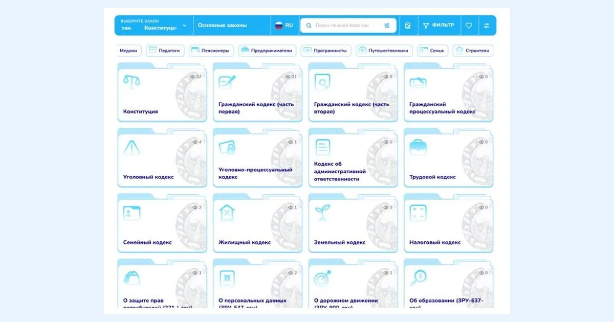
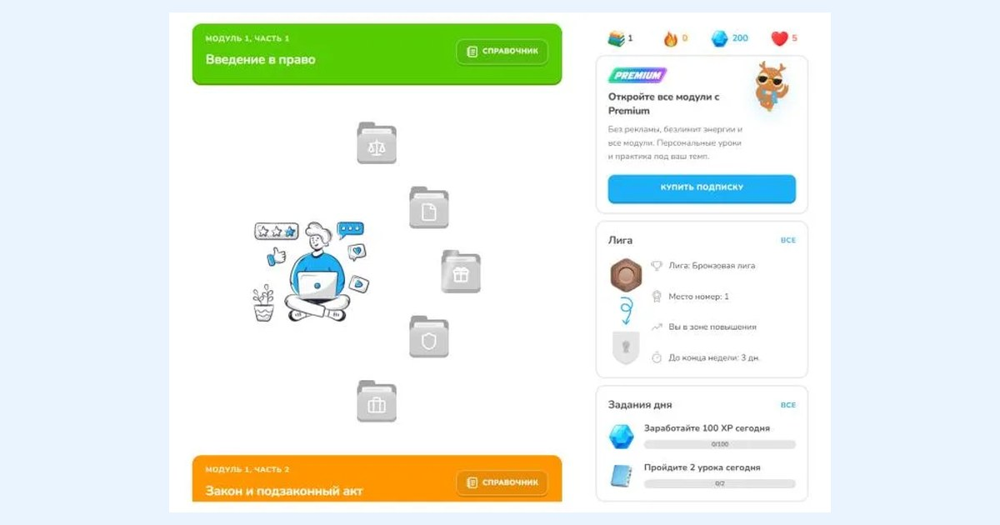

<p align="center">
  
</p>

<h1 align="center">VEOSKILL MCP</h1>

<p align="center">
  The laws of Uzbekistan and legal study, right inside your AI assistant.<br>
  <a href="https://veoskill.uz">veoskill.uz</a> ·
  <a href="https://registry.modelcontextprotocol.io/v0/servers?search=uz.veoskill">MCP Registry</a> ·
  <a href="#connect">Connect</a> ·
  <a href="#tools">Tools</a> ·
  <a href="#privacy-and-safety">Privacy</a>
</p>

<p align="center">
  
  
  
</p>

```
https://veoskill.uz/mcp
```

VEOSKILL is a free platform for reading and studying the law of the Republic of Uzbekistan: the full base of
legislation (46,000+ acts from lex.uz: the Constitution, codes, laws, decrees) in Russian, Uzbek and English, plus
courses, games and duels for law students. This MCP server connects Claude, ChatGPT, Gemini, VS Code, Cursor and other
AI apps to a VEOSKILL account, so the assistant can quote the exact text of an article, keep your notes and
highlights, and teach you from the lessons you have reached.

<p align="center">
  
  
</p>

## What you can ask

- *"Find what the Labour Code says about overtime and quote the article."*
- *"Highlight article 77 of the Labour Code and add a note: check before the exam."*
- *"Where did I stop in my course? Quiz me on that lesson."*
- *"Show my mistakes from this week and explain each one with the law."*
- *"Follow the Tax Code and tell me when it changes."*

## Connect

The server is remote: nothing to install or run. Every app opens the VEOSKILL sign-in and a consent screen where you
choose what the assistant may see and do. A free account at [veoskill.uz](https://veoskill.uz) is enough.

| App | How |
|---|---|
| **Claude** (web, desktop) | Settings → Connectors → Add custom connector → name `VEOSKILL`, URL `https://veoskill.uz/mcp` |
| **ChatGPT** | Plugins → `+` → Add custom MCP server → URL above, auth OAuth |
| **Gemini** (web) | Settings → Connectors → `+` → paste the URL |
| **VS Code** | [Install](https://vscode.dev/redirect/mcp/install?name=veoskill&config=%7B%22type%22%3A%22http%22%2C%22url%22%3A%22https%3A%2F%2Fveoskill.uz%2Fmcp%22%7D) or `MCP: Add Server` → HTTP → URL above |
| **Cursor** | [Install](cursor://anysphere.cursor-deeplink/mcp/install?name=veoskill&config=eyJ1cmwiOiJodHRwczovL3Zlb3NraWxsLnV6L21jcCJ9) |
| **Claude Code** | `claude mcp add --transport http veoskill https://veoskill.uz/mcp` |
| **Codex** | `codex mcp add veoskill --url https://veoskill.uz/mcp && codex mcp login veoskill` |
| **Other apps** | any client with Streamable HTTP and OAuth (dynamic client registration) |

Step-by-step guides for 21 apps, with one-click buttons, are in your account: **Settings → AI** on
[veoskill.uz](https://veoskill.uz).

Config for apps that read a JSON file:

```json
{
  "mcpServers": {
    "veoskill": { "url": "https://veoskill.uz/mcp" }
  }
}
```

## Tools

Every tool has a title and `readOnlyHint` / `destructiveHint` annotations. Tools appear only for the permissions you
allow on the consent screen, and you can change them or disconnect any app at any time in Settings → AI.

**Laws** (read)

| Tool | What it does |
|---|---|
| `search_laws` | Search the laws of Uzbekistan |
| `get_law_articles` | Articles of a law (table of contents) |
| `get_law_article` | Exact text of an article |

**Notes, highlights, favourites**

| Tool | What it does |
|---|---|
| `get_law_marks` | My highlights and notes in laws |
| `highlight_law_text`, `remove_law_highlight` | Highlight a quote / remove a highlight |
| `undo_law_marks`, `redo_law_marks`, `clear_law_marks` | Undo, redo, clear the highlights of a law |
| `add_law_note`, `edit_law_note`, `delete_law_note` | Notes on a law |
| `get_law_favorites`, `add_law_favorite`, `remove_law_favorite` | Favourite laws and articles |
| `watch_law` | Follow changes of a law |

**Learning**

| Tool | What it does |
|---|---|
| `get_profile`, `get_progress` | Profile, XP, streak; where I stopped |
| `list_courses`, `get_course_plan`, `get_lesson` | Courses, course plan, lesson content (lessons you have reached) |
| `get_mistakes`, `get_review_due`, `mark_lesson_reviewed` | Mistakes, lessons due for review, mark a lesson reviewed with AI |
| `get_achievements`, `get_league`, `get_duels` | Achievements, league, duels |

**Account and community**

| Tool | What it does |
|---|---|
| `get_settings`, `set_language`, `set_law_reading` | Settings, language, how laws look |
| `get_subscription` | Plan and its end date |
| `get_notifications`, `mark_notifications_read` | Notifications |
| `list_sessions`, `end_session` | Signed-in devices, sign out a device |
| `get_profile_look`, `set_name_badge`, `set_status_sticker`, `set_profile_cover` | Profile look |
| `list_forum_threads`, `get_forum_thread`, `create_forum_thread`, `reply_forum_post`, `edit_forum_post`, `vote_forum` | Forum |

## Privacy and safety

- **Your consent first.** Sign-in is OAuth 2.1 with PKCE; you pick the permissions, write access is off by default.
- **Never through MCP:** payments and purchases, gems and XP, finishing lessons, account deletion, other people's
  data (messages, follows, duels).
- **Course content is protected:** only lessons you have reached, with a daily limit, so the assistant teaches you
  instead of exporting a course.
- **Limits:** calls per connection are rate-limited; tokens live an hour and are refreshed by the app.
- **Disconnect any time:** Settings → AI on veoskill.uz shows every connected app and its activity.
- Privacy policy: <https://veoskill.uz/en/legal/policies#privacy>

The law texts are the official texts from [lex.uz](https://lex.uz), word for word; the legally binding publication is
the one on lex.uz.

## Support

Questions and problems: open an [issue](../../issues) in this repository or write through
[veoskill.uz](https://veoskill.uz).

---

<details>
<summary><b>Русский</b></summary>

VEOSKILL - бесплатная база законов Республики Узбекистан (46 000+ актов на русском, узбекском и английском) и
обучение праву. Этот MCP-сервер подключает Claude, ChatGPT, Gemini, VS Code, Cursor и другие нейросети к аккаунту
VEOSKILL: точные цитаты статей, ваши заметки и выделения, уроки, ошибки и повторение.

Адрес сервера: `https://veoskill.uz/mcp`. Инструкции для 21 приложения с кнопками подключения: **Настройки →
Нейросети** на [veoskill.uz](https://veoskill.uz). Вход через OAuth: вы сами выбираете, что нейросети можно видеть
и делать, и в любой момент отключаете её.

</details>

<details>
<summary><b>O‘zbekcha</b></summary>

VEOSKILL - O‘zbekiston Respublikasi qonunlarining bepul bazasi (rus, o‘zbek va ingliz tillarida 46 000 dan ortiq
hujjat) va huquqni o‘rganish platformasi. Ushbu MCP-server Claude, ChatGPT, Gemini, VS Code, Cursor va boshqa
sun’iy intellektlarni VEOSKILL hisobiga ulaydi.

Server manzili: `https://veoskill.uz/mcp`. 21 ta ilova uchun ko‘rsatmalar: [veoskill.uz](https://veoskill.uz)
saytida **Sozlamalar → Neyrotarmoqlar**.

</details>
